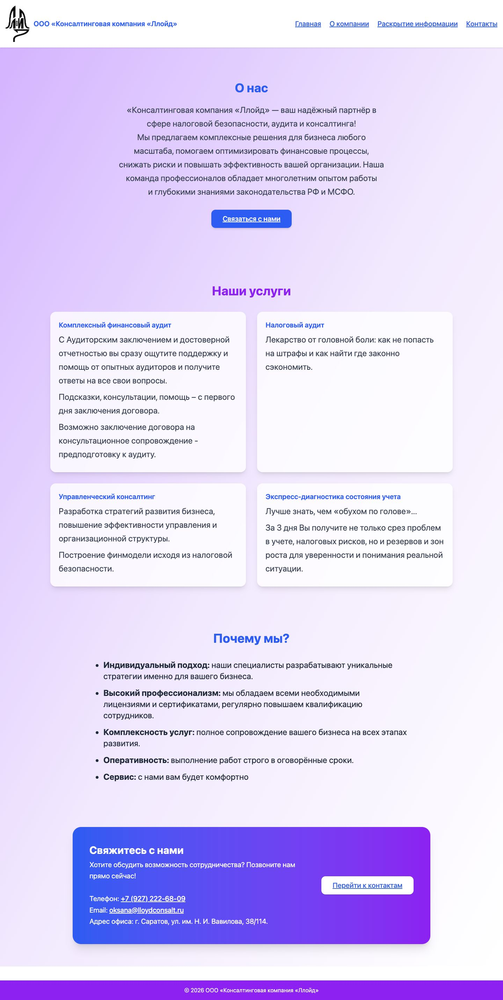

# Lloyd Consulting Website

A production corporate website delivered for an audit and business-consulting company. The interface
presents services, company background, contacts, and the statutory disclosure required for an audit firm.



[Production website](https://ллойд.рф) · Client project · Content language: Russian

## Highlights

- Responsive navigation with a compact mobile menu
- Service, company, contact, and statutory-disclosure routes
- Keyboard-accessible links and labelled menu controls
- Click-to-call and email actions plus an embedded office map
- Static deployment with no cookies, account, database, or build-time secrets

## Stack

- React 19 and React Router 7
- Vite 7 and Tailwind CSS 4
- Lucide icons
- ESLint and Bun 1.4
- GitHub Actions, dependency audit, Dependabot, and GitHub Pages

## Local development

```bash
git clone https://github.com/RAZEX0LOL/lloid.git
cd lloid
bun install --frozen-lockfile
bun run dev
```

Verify the production path:

```bash
bun run check
bun audit --production
```

The repository contains the frontend implementation only. Business claims and statutory information
are supplied as website content and are not independently verified by this codebase.

## Rights

The company name, logo, copy, and statutory information belong to their respective owner. No
open-source licence is granted for those materials.
